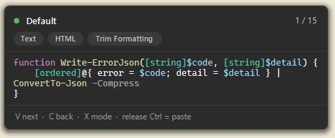
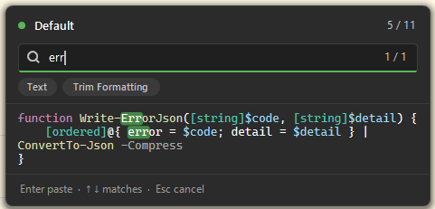

# Clipjump-Ultra

A multiple-clipboard manager for Windows, built with AutoHotkey v1 (64-bit).

Clipjump-Ultra records everything you copy, keeps it without limits, and lets you paste any earlier
clip with a few keystrokes. This fork adds a Windows 11 (Fluent) design, a formatted
preview, protected password clips, and optional AI functions: correct, translate and read aloud.

It is based on [Clipjump](https://github.com/aviaryan/Clipjump) by Avi Aryan, through the
[Clipjump-plus](https://github.com/telppa/Clipjump-plus) fork (Clipjump v12.5).

---

## Contents

- [Features](#features)
- [Requirements](#requirements)
- [Getting started](#getting-started)
- [Keyboard reference](#keyboard-reference)
- [Configuration](#configuration)
- [Privacy and security](#privacy-and-security)
- [Building from source](#building-from-source)
- [Project structure](#project-structure)
- [Credits and license](#credits-and-license)

---

## Features

### Clipboard management (from Clipjump)

- Unlimited clip history with channels, tags, fixed clips and a searchable history window
- **Paste mode**: hold `Ctrl`, tap `V` to step through clips, release `Ctrl` to paste
- Paste formats such as *Trim formatting*, *Join lines* or *Sentence case*
- Multi-paste sessions, Hold Clip, one-time stop, Channel Organizer, plugin manager

### Additions in Clipjump-Ultra

| Area | What it does |
|---|---|
| **Fluent design** | Windows 11 look for paste mode, toasts, Action Mode and dialogs; light and dark theme follow Windows |
| **Formatted preview** | Rich text from Word, Outlook, browsers and VS Code is shown with bold, italic, underline, colours, links and lists. When a paste format is selected, the preview shows its plain result |
| **Syntax highlighting** | XML/HTML, JSON, PowerShell and JavaScript/TypeScript in the preview |
| **Search in the preview** | `F` in paste mode (`Ctrl` still held) opens a search box inside the preview panel; matches are highlighted |
| **Password clips** | Detected through the markers password managers set on the clipboard; masked in the preview, DPAPI-encrypted on disk, deleted after a set lifetime, never exported, edited, read aloud or sent to an LLM |
| **Correct text** (`W`) | Fixes spelling and grammar with a local, OpenAI-compatible LLM. In Action Mode the corrected text replaces the selection if the field is editable (also in Word), otherwise it goes to the clipboard |
| **Translate** (`T`) | Same flow as correct, with a configurable translation prompt |
| **Read aloud** (`R`) | Text-to-speech with [ElevenLabs](https://elevenlabs.io); MP3 files are saved anonymously, reused for identical text and logged |
| **Image as Base64** (`B`) | Pastes an image clip as a Base64 data URI for HTML or Markdown |
| **Clip Actions** | Window (formerly *Common Formats*) with translate, correct and read aloud as separate entries |
| **Explorer** | *Copy File Data* and *Copy Folder Path* work with Windows 11 Explorer tabs |
| **Extended Settings window** | Privacy, local LLM, ElevenLabs and image options, including this month's ElevenLabs usage |

 


---

## Requirements

- Windows 11, 64-bit (Windows 10 should work, but the design targets Windows 11)
- [AutoHotkey v1.1](https://www.autohotkey.com/) (Unicode 64-bit), to run or compile from source
- Optional, for the AI functions:
  - a local OpenAI-compatible LLM server (for example SGLang, vLLM, Ollama or LM Studio) for `W` and `T`
  - an ElevenLabs account and API key for `R` (uses ElevenLabs credits)

---

## Getting started

There is no prebuilt release yet. Either run the script directly or
[build the executable](#building-from-source).

1. Clone the repository:
   ```powershell
   git clone https://github.com/magomic/Clipjump-Ultra.git
   ```
2. Start `Clipjump.ahk` with AutoHotkey v1 (64-bit), or start your compiled `Clipjump.exe`.
   On the first start, Clipjump creates `settings.ini` and the `cache\` folder next to the script.
3. Copy a few things, then hold `Ctrl` and tap `V` to open paste mode.
4. Optional: set the environment variables for the AI functions (see [Configuration](#configuration)).

> **Windows Defender** sometimes reports self-compiled AutoHotkey programs (for example as
> `Program:Win32/Contebrew.A!ml`). This is a known false positive of the machine-learning
> detection. If it happens to you, check the file and add an exclusion for your own build.

---

## Keyboard reference

### Paste mode (hold `Ctrl`)

| Key | Action |
|---|---|
| `V` / `C` | Next / previous clip |
| Release `Ctrl` | Paste the current clip |
| `X` | Cancel, move, delete or copy the clip (press repeatedly) |
| `Z` | Change the paste format |
| `Space` | Fix the clip at its position |
| `S` | Put the current clip on the system clipboard |
| `E` | Export the clip |
| `H` | Edit the clip |
| `#` | Tag the clip |
| `Q` | Move the clip to the first position |
| `A` | Jump to the first clip of the channel |
| `1` … `9` | Jump n clips ahead |
| `Up` / `Down` | Next / previous channel |
| `F` | Search (search box inside the preview) |
| `Enter` | Start a multi-paste session |
| `W` | Correct the clip with the local LLM and paste the result |
| `T` | Translate the clip with the local LLM and paste the result |
| `R` | Read the clip aloud (ElevenLabs) |
| `B` | Paste an image clip as Base64 |
| Hold `Shift` | Delete the clip after pasting |
| `F1` | Help |

### Action Mode (`Ctrl+Shift+A`, then a key)

| Key | Action |
|---|---|
| `W` | Correct the selected text (replaces the selection, or goes to the clipboard) |
| `T` | Translate the selected text (same behaviour) |
| `R` | Read the selected text aloud |
| `H` | History window |
| `O` | Channel Organizer |
| `C` / `X` / `F` | Copy file path / folder path / file data |
| `B` | Hold Clip |
| `S` | One-time stop (do not record the next copy) |
| `D` | Disable Clipjump |
| `P` | Pit swap |
| `E` | Settings |
| `M` | Plugin manager |
| `L` | Ignored windows (class tool) |
| `F1` / `F2` | Help / paste mode shortcuts |
| `Esc` | Close Action Mode |

All shortcuts can be changed in the Settings window.

---

## Configuration

Settings are stored in `settings.ini` next to the program. Most options are available in the
Settings window (Action Mode `E`); the rest can be edited in the file.

### Environment variables

API keys and server addresses are read only from environment variables, never from
`settings.ini`:

| Variable | Used for | Example |
|---|---|---|
| `LOCAL_LLM_URL` | Correct (`W`) and translate (`T`) | `http://localhost:8000/v1` |
| `ELEVENLABS_API_KEY` | Read aloud (`R`) | your ElevenLabs API key |

```powershell
setx LOCAL_LLM_URL "http://localhost:8000/v1"
setx ELEVENLABS_API_KEY "<your key>"
```

Clipjump reads both from the user environment on every use, so a restart is not needed after
`setx`. `LOCAL_LLM_URL` is the base URL of the OpenAI-compatible API; `/chat/completions` is added
automatically. To show the ElevenLabs quota in the Settings window, the key needs the
**User: Read** permission.

### `settings.ini` sections added by this fork

| Section | Key | Default | Meaning |
|---|---|---|---|
| `[Privacy]` | `maskPasswords` | `1` | Show passwords as `ab****yz` in the preview |
| | `passwordClipEncryption` | `1` | Store password clips DPAPI-encrypted |
| | `passwordLifetime` | `10` | Minutes until a password clip is deleted (`0` = never) |
| `[LocalLLM]` | `model` | *(empty)* | Model name; empty uses the first model the server lists |
| | `reasoningEffort` | `low` | Thinking level: `none`, `low`, `medium`, `high` |
| | `prompt` | German: correct only the errors, do not rephrase | Prompt for correct (`W`) |
| | `translatePrompt` | German: translate into English, English into German | Prompt for translate (`T`) |
| | `timeoutSec` | `180` | Request timeout |
| `[ElevenLabs]` | `voiceId` | *(empty)* | ElevenLabs voice ID (required) |
| | `modelId` | `eleven_multilingual_v2` | ElevenLabs model |
| | `maxChars` | `5000` | Longer texts are cut (cost limit) |
| | `mp3Dir` | `c:\my\mp3` | Folder for MP3 files and the log; change it to a folder of your own |
| | `mp3Save` | `1` | Keep MP3 files (`0` = play and delete) |
| | `mp3KeepDays` | `30` | Delete own MP3 files after n days (`0` = keep) |
| | `mp3Cache` | `1` | Reuse the saved MP3 for identical text, voice and model |
| `[Base64]` | `dataUri` | `1` | Paste `data:image/png;base64,…` instead of the bare Base64 string |
| `[Advanced]` | `pasteModeStyle` | `modern` | `modern` (Fluent panel) or `classic` (tooltip) |
| | `pasteModeTheme` | `auto` | `auto`, `light` or `dark` |
| | `pasteModeHighlight` | `1` | Syntax highlighting in the preview |
| | `pasteModeRichText` | `1` | Formatted preview of rich text clips |

### Languages

English and German contain all texts of this fork. Other translations show new texts in English.

---

## Privacy and security

- **Your data stays local.** Clips, history and thumbnails are stored in `cache\` next to the
  program. Neither `cache\` nor `settings.ini` is part of the repository.
- **Password clips** are recognised through the clipboard markers that password managers set
  (`ExcludeClipboardContentFromMonitorProcessing`, `Clipboard Viewer Ignore`). They are never
  written to the history database. They are stored encrypted with Windows DPAPI (readable only by
  your Windows account) and deleted after their lifetime. When pasted, they are marked so that
  Windows clipboard history and cloud sync ignore them.
- **What leaves your computer:**
  - Correct and translate send the text to the server in `LOCAL_LLM_URL`. With a local server,
    nothing leaves your network.
  - Read aloud sends the text to ElevenLabs. The log (`ElevenLabs-Log.csv` in `mp3Dir`) records
    time, length, voice, model and a hash. It does not contain the text, and MP3 file names
    contain only a timestamp.
  - Password clips are never sent anywhere.

---

## Building from source

1. Install AutoHotkey v1.1, which includes the compiler `Ahk2Exe`.
2. Compile:
   ```powershell
   & "C:\Program Files\AutoHotkey\v1\Compiler\Ahk2Exe.exe" /in Clipjump.ahk /out Clipjump.exe `
     /icon icons\icon.ico /bin "C:\Program Files\AutoHotkey\v1\Compiler\Unicode 64-bit.bin"
   ```
3. Optional: set the version information:
   ```powershell
   .\tools\Set-VersionInfo.ps1 -Exe Clipjump.exe -Version 12.7
   ```

A running `Clipjump.exe` cannot be overwritten. Exit it first, or rename it before compiling.

### Documentation

The help file (`Clipjump.chm`) is built from the `website\` folder: build it with Jekyll, then
compile the result with Microsoft HTML Help Workshop (`hhc`).

---

## Project structure

```text
Clipjump.ahk         Main script (auto-execute section, paste mode, Action Mode)
lib/                 Modules
  CJPanel.ahk          Fluent panels, preview, syntax and rich text rendering
  CJTheme.ahk          Light/dark theme and accent colours
  CJPassword.ahk       Password clip detection, masking, DPAPI, expiry
  CJWrite.ahk          Correct and translate with the local LLM
  CJSpeak.ahk          Read aloud with ElevenLabs, MP3 cache and log
  CJBase64.ahk         Image to Base64 / data URI
  Settings GUI Plug.ahk, History GUI Plug.ahk, channelOrganizer.ahk, ...
plugins/             Bundled plugins (paste formats, Clip Actions, tools)
languages/           Translations (english.txt is the base, others override it)
icons/               Tray and program icons
website/             Source of the help file and the original website
tools/               Build helpers
```

### Plugins

Plugins live in `plugins\` and are managed with the plugin manager (Action Mode `M`). Plugins
for the original Clipjump are collected in
[clipjump-addons](https://github.com/aviaryan/clipjump-addons).

---

## Credits and license

- **Clipjump** © 2013 Avi Aryan – [aviaryan/Clipjump](https://github.com/aviaryan/Clipjump)
- **Clipjump-plus** by telppa – [telppa/Clipjump-plus](https://github.com/telppa/Clipjump-plus)
  (Chinese translation, BTT tooltips and many fixes)
- **Clipjump-Ultra** modifications © 2026 Erhan Tuna

Licensed under the [Apache License 2.0](LICENSE). See [NOTICE.txt](NOTICE.txt) for the original
notice.
